# flow.md — Flowchart Backend

Diagram Mermaid untuk alur backend BeasiswaMatch. Semua endpoint di bawah prefix `/api`.
Salin blok `mermaid` ke penampil Mermaid (GitHub, VS Code, mermaid.live).

> **Cara melihat:** setiap diagram berada di dalam blok berpagar `mermaid`.
> Render langsung di GitHub/VS Code, atau pakai file satu-diagram-per-file di `docs/flows/`
> (mis. `docs/flows/01-peta-sistem.mmd`). Jangan menempelkan seluruh dokumen ini ke mermaid.live —
> penampil itu hanya menerima satu diagram, sehinbgga judul dan paragraf di atas memicu
> `UnknownDiagramError`.

---

## 1. Peta sistem

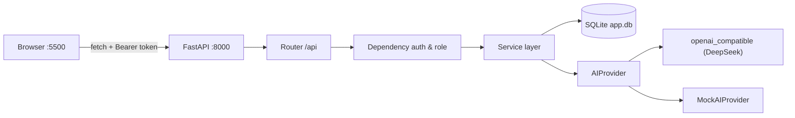

---

## 2. Pipeline request dan otorisasi

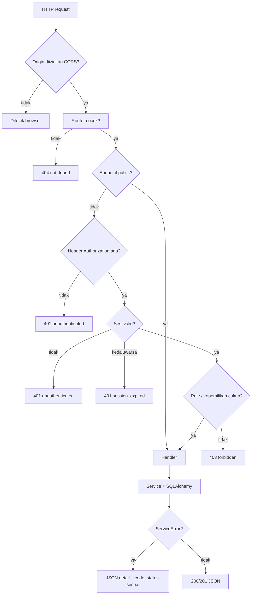

---

## 3. Login, sesi, logout

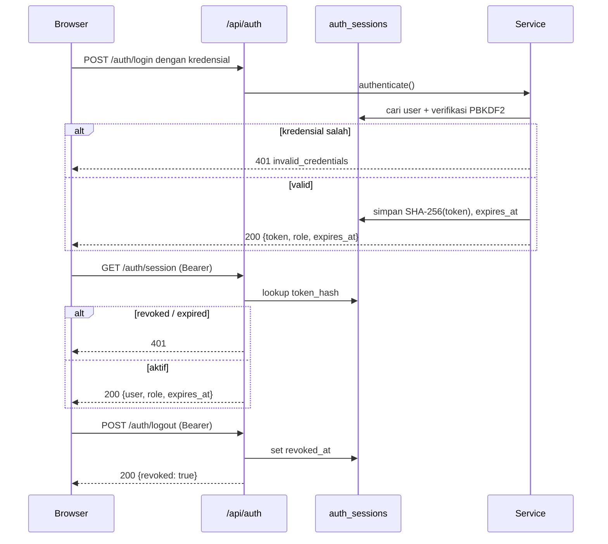

---

## 4. Onboarding profil (analisis → kirim sekali)

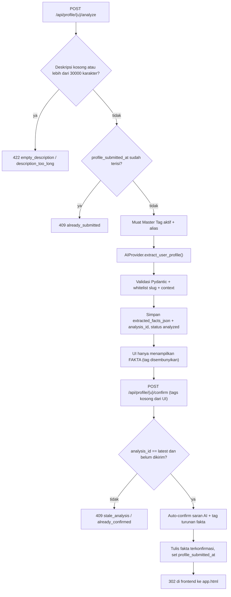

### Cabang fallback AI

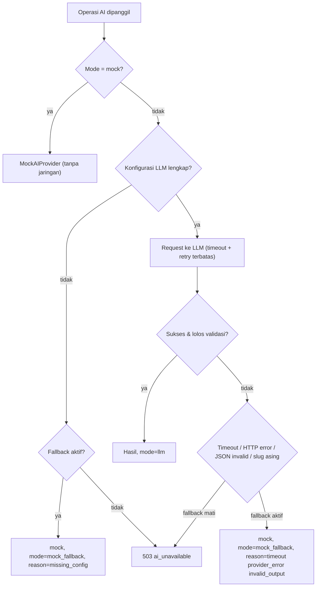

---

## 5. Rekomendasi, hot, dan recent

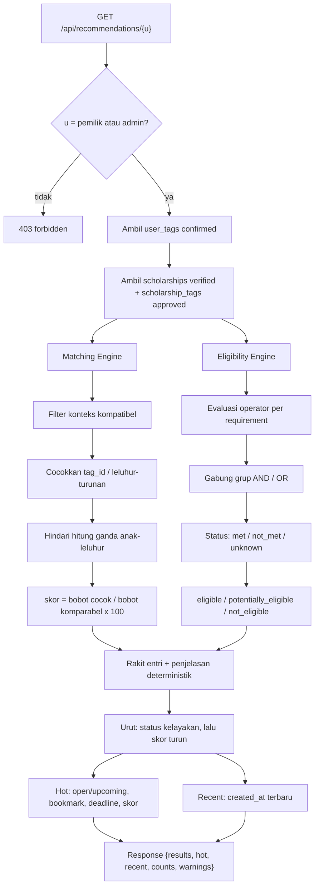

---

## 6. Siklus hidup beasiswa (admin)

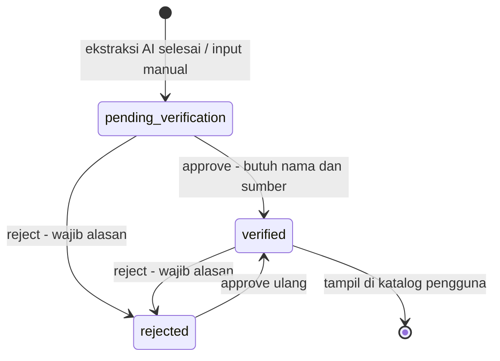

### Dua jalur pembuatan beasiswa

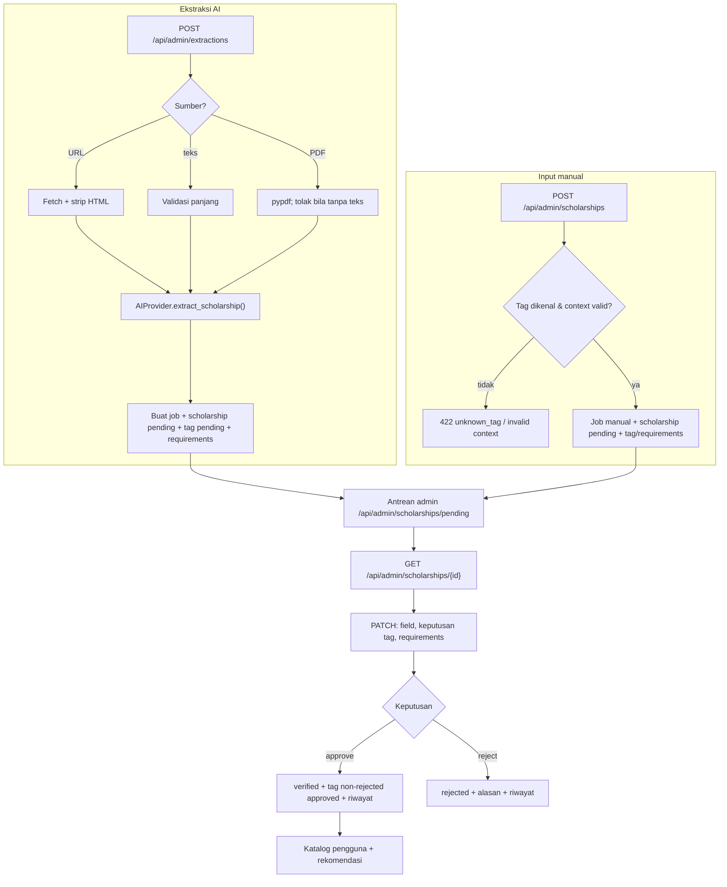

---

## 7. Kiriman screenshot pengguna

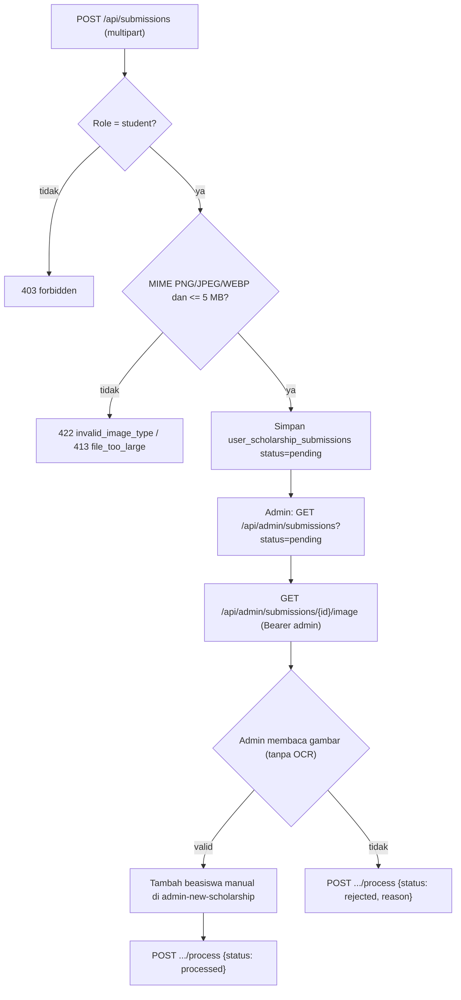

---

## 8. Model data (ringkas)

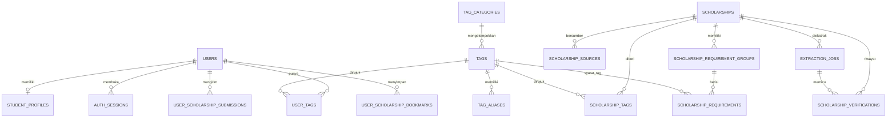

---

## 9. Reset password pengguna (admin)

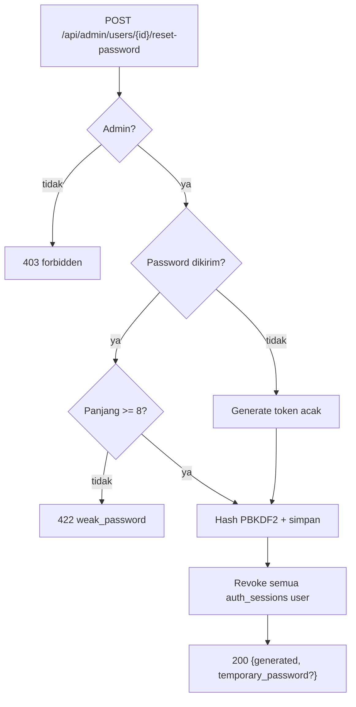

---

## 10. Bagaimana rekomendasi dimunculkan (end-to-end)

Dari pemicu di UI sampai kartu tampil — termasuk titik di mana profil belum dikirim, dan
mengapa ada tiga kelompok kartu.

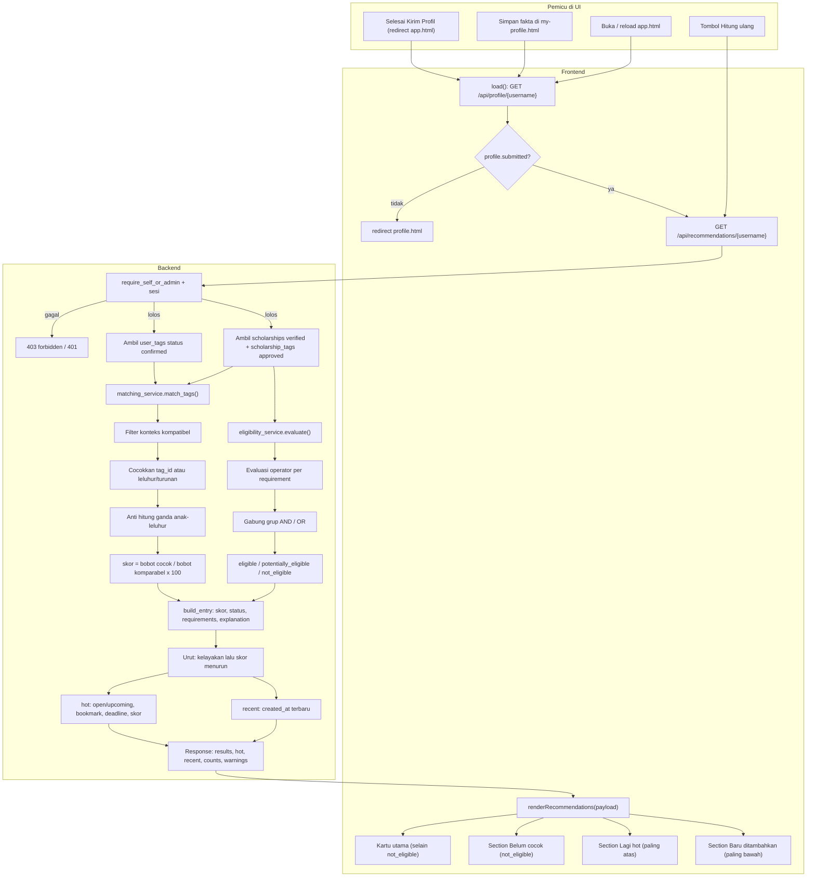

Catatan perilaku:

- **Belum pernah kirim profil** → `app.html` tidak menghitung apa pun; langsung redirect ke `profile.html`.
- **Profil terkirim** → kartu utama memuat `eligible` dan `potentially_eligible`; `not_eligible` dipisah
  ke "Belum cocok" agar skor tinggi tidak menyamarkan persyaratan yang gagal.
- **Tombol Hitung ulang** memanggil ulang `GET /api/recommendations/{username}` (bukan `POST
  /api/recommendations/recompute`; endpoint POST itu tersedia untuk pemakaian API langsung).
- **Section hot** dihitung dari seluruh hasil (bukan dari kartu utama), **recent** dari `created_at`;
  keduanya maksimal 3 kartu dan boleh tumpang tindih.
- Skor `null` + "Belum cukup preferensi" muncul bila tidak ada tag pembanding — bukan 0%.
